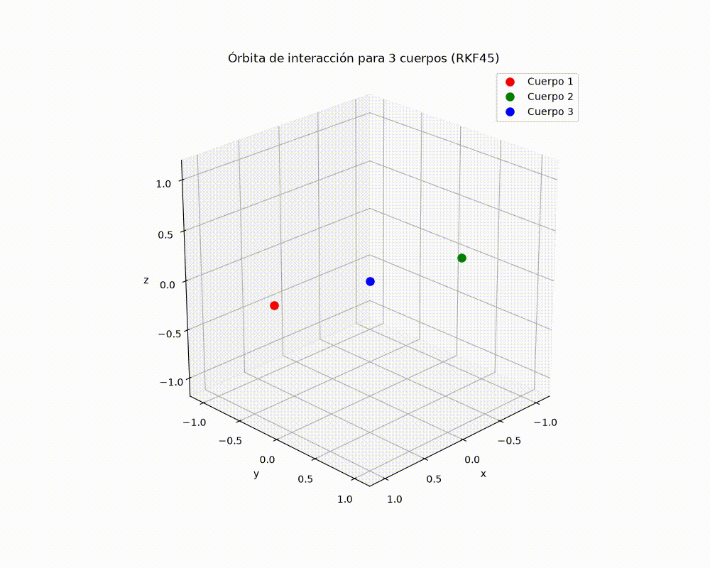
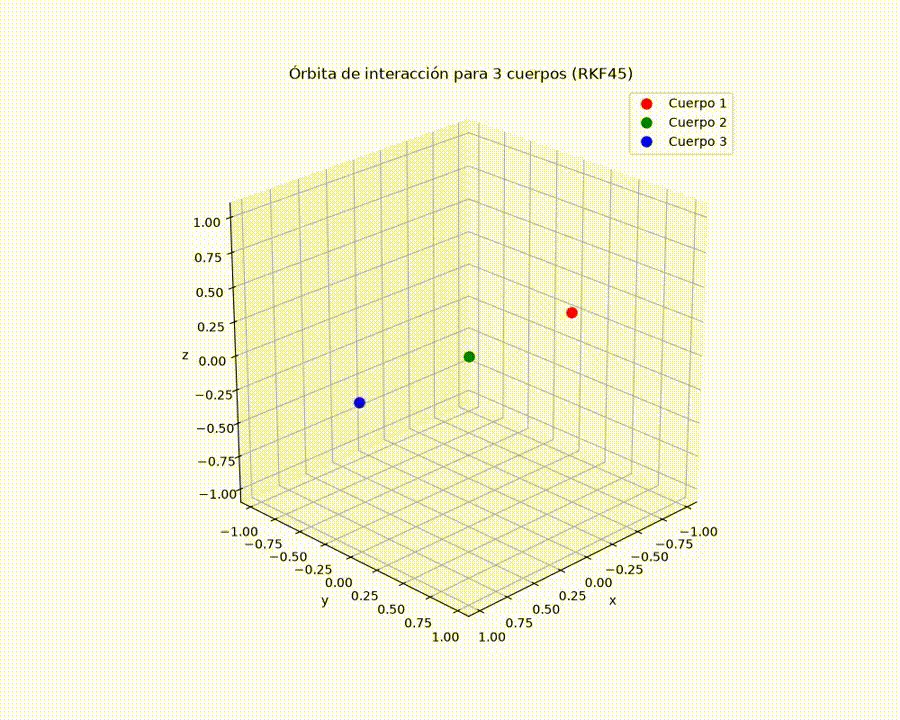
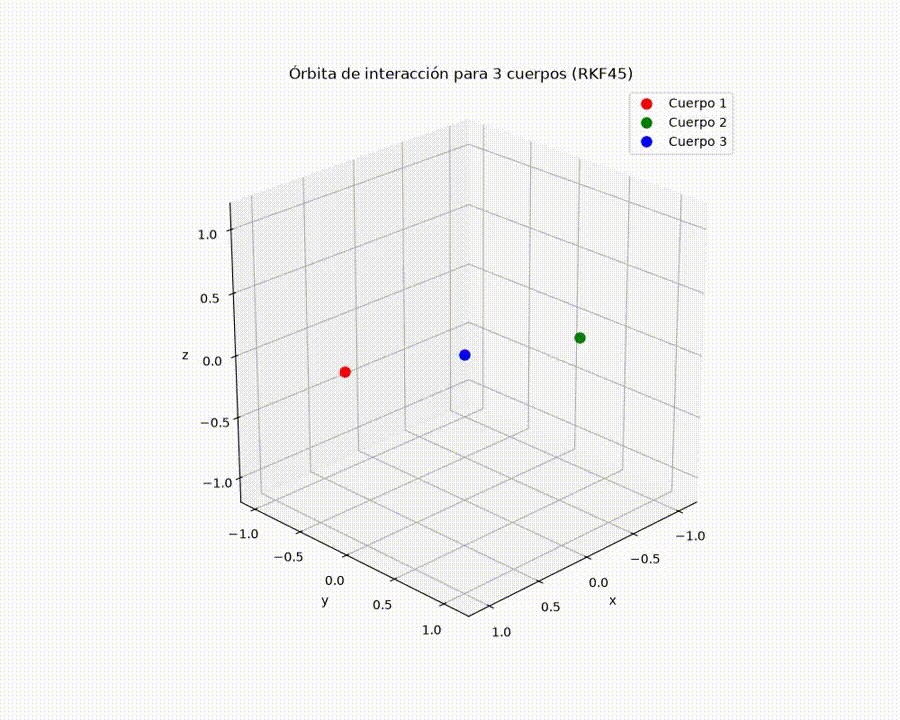
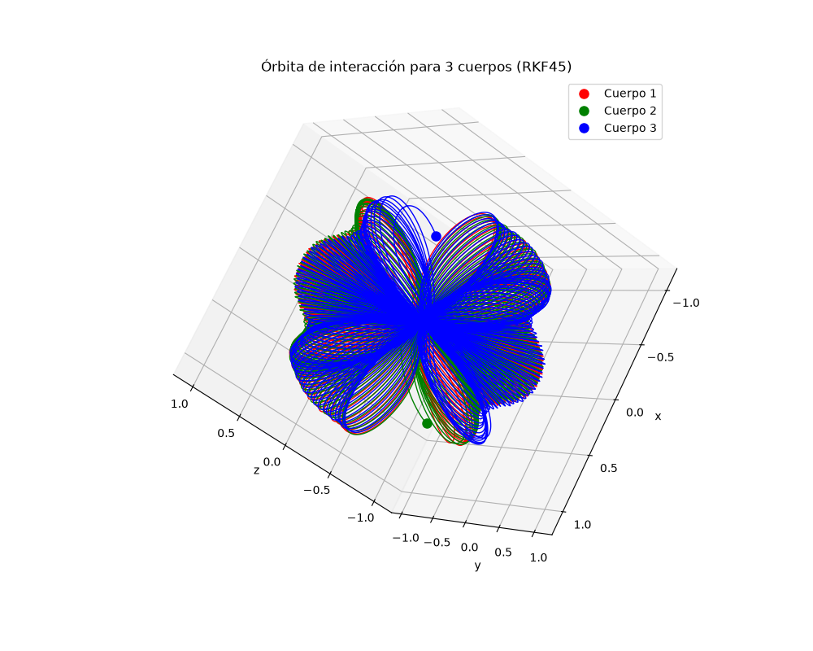
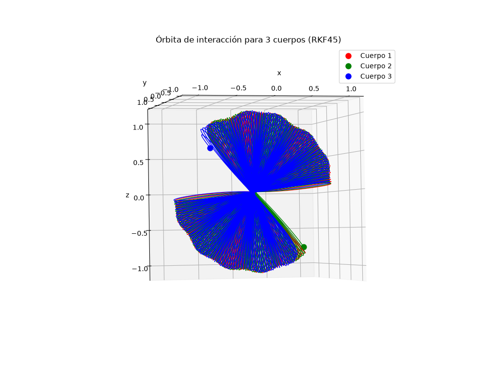
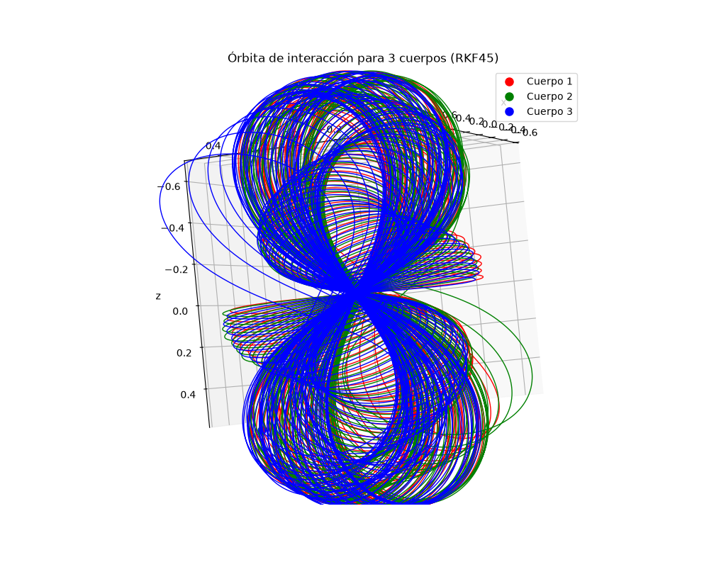

# Simulación gravitatoria de tres cuerpos

Programa en Python que simula el movimiento gravitatorio de tres cuerpos en tres dimensiones. Integra las ecuaciones de movimiento mediante el método Runge–Kutta–Fehlberg de órdenes 4 y 5 (RKF45), con ajuste adaptativo del paso, y crea una visualización interactiva y un video MP4 de las trayectorias.

## Características

- Interacción gravitatoria entre tres cuerpos con potencial suavizado de Plummer.
- Configuración inicial predeterminada: órbita periódica conocida como figura de ocho.
- Otras condiciones iniciales incluidas en el código: configuración colineal de Euler, figura de ocho perturbada fuera del plano XY y órbitas circulares.
- Integración RKF45 con control de error y paso adaptativo.
- Gráfica 3D interactiva con Matplotlib.
- Exportación de la animación a `trayectoria_3cuerpos.mp4`.

## Requisitos

- Python 3.9 o posterior.
- NumPy.
- Matplotlib con un backend Qt disponible.
- FFmpeg instalado y accesible desde el `PATH` para exportar MP4.
- Un entorno gráfico para abrir la ventana interactiva.

## Instalación

Clona el repositorio y entra en su carpeta:

```bash
git clone https://github.com/MCR26/Simulacion-del-problema-de-3-cuerpos
cd Simulacion-del-problema-de-3-cuerpos
```

Se recomienda usar un entorno virtual:

```bash
python -m venv .venv
```

Actívalo en Windows:

```powershell
.venv\Scripts\Activate.ps1
```

O en macOS/Linux:

```bash
source .venv/bin/activate
```

Instala las dependencias de Python:

```bash
python -m pip install -r requirements.txt
```

Instala FFmpeg por separado según tu sistema operativo y confirma que el ejecutable `ffmpeg` esté en el `PATH`. La exportación MP4 de Matplotlib depende de FFmpeg; sin él, el video no se podrá generar.

## Ejecución

```bash
python simulacion_tres_cuerpos.py
```

El programa muestra mensajes de avance en la terminal, abre una ventana 3D y guarda `trayectoria_3cuerpos.mp4` en el directorio de trabajo desde el que se ejecutó.

## Configuración

Los parámetros principales están definidos al inicio del script:

| Parámetro | Descripción |
| --- | --- |
| `G` | Constante gravitatoria usada por la simulación. El valor predeterminado es `1.0`, en unidades normalizadas. |
| `m1`, `m2`, `m3` | Masas de los tres cuerpos. |
| `eps` | Parámetro de suavizado del potencial gravitatorio. Con el valor predeterminado `1e-4`, la longitud de suavizado es `sqrt(eps) = 0.01` en las unidades del modelo. Suaviza la interacción durante los encuentros cercanos, por lo que cambiarlo también puede modificar las trayectorias. No representa el radio físico de los cuerpos. |
| `t0`, `tf` | Tiempo inicial y final de integración. |
| `h` | Paso inicial y paso máximo. |
| `tol` | Tolerancia usada para aceptar o rechazar pasos del integrador. |
| `hmin` | Paso mínimo permitido, calculado inicialmente como h / 100. |

Para cambiar el escenario, edita las posiciones `r1`, `r2`, `r3` y velocidades `v1`, `v2`, `v3` en la sección de condiciones iniciales. Los bloques alternativos son ejemplos comentados: habilita uno de ellos y deshabilita el bloque activo para usarlo.

## Salidas

- `trayectoria_3cuerpos.mp4`: animación de las posiciones y trayectorias de los cuerpos.
- `simulaciones/trayectoria_3cuerpos_figura_8.gif`: simulación con las condiciones iniciales de la figura de ocho y un tiempo final (tf) de 10.

  

- `simulaciones/trayectoria_3cuerpos_euler_colineal.gif`: simulación con las condiciones iniciales de Euler colineal y un tiempo final (tf) de 100. Para facilitar la visualización, la velocidad de reproducción del GIF se aceleró 5 veces. Esto no modifica la simulación ni los cálculos.

  

- La figura 3D aparece en una ventana interactiva durante la creación del video. Las interacciones con esa ventana —como rotar o ampliar la vista— también pueden quedar reflejadas en el video.

- `simulaciones/trayectoria_3cuerpos-8_sin_simetria.gif`: simulación de la figura de ocho sin simetría y un tiempo final (tf) de 500. Para facilitar la visualización, la velocidad de reproducción del GIF se aceleró 12 veces. Esto no modifica la simulación ni los cálculos.

  

La ventana interactiva permanece abierta al terminar y permite rotar, trasladar y ampliar la vista. Estas capturas muestran distintas perspectivas de la trayectoria:







El script no exporta automáticamente los datos numéricos de posición y tiempo a CSV u otro formato.
Las imágenes y los GIFs son visualizaciones incluidas en el repositorio; el script genera el MP4.

## Notas sobre el método

El integrador calcula estimaciones de cuarto y quinto orden y usa su diferencia para ajustar el tamaño de paso. En el código, los pasos aceptados actualizan el estado usando la estimación de cuarto orden (`y4`). La tolerancia se aplica a la norma global del vector de error escalada por el paso, no a una tolerancia relativa e individual para cada componente.

El parámetro `eps` modifica la ley de fuerza en distancias pequeñas; no es solo un control de visualización. Cambiarlo altera el modelo y la dinámica simulada. Los valores de masa, distancia, tiempo y velocidad se interpretan en unidades normalizadas consistentes con `G = 1`.

## Solución de problemas

- **No se genera el MP4:** instala FFmpeg y asegúrate de que `ffmpeg` se pueda encontrar desde la terminal. Revisa también que el directorio de ejecución permita crear archivos.
- **No abre la ventana gráfica:** ejecuta el programa en un escritorio con interfaz gráfica y comprueba que haya un backend Qt compatible con Matplotlib instalado.
- **La simulación termina antes de `tf`:** revisa los mensajes de la terminal. Un encuentro cercano puede hacer que el integrador alcance el paso mínimo antes de satisfacer `tol`; considera ajustar las condiciones iniciales, `tol`, `h` o `eps` y evalúa cómo afecta al resultado.
- **El video tarda mucho:** el número de pasos depende de la dinámica y el control de error. El bucle de animación guarda un cuadro cada diez puntos calculados.

## Estructura del repositorio

```text
.
├── README.md
├── requirements.txt
└── simulacion_tres_cuerpos.py
```

## Licencia

Este proyecto se distribuye bajo la licencia MIT. Consulta el archivo [LICENSE](LICENSE) para ver el texto completo.

## Autoría

Moisés Cerdas Rivera


